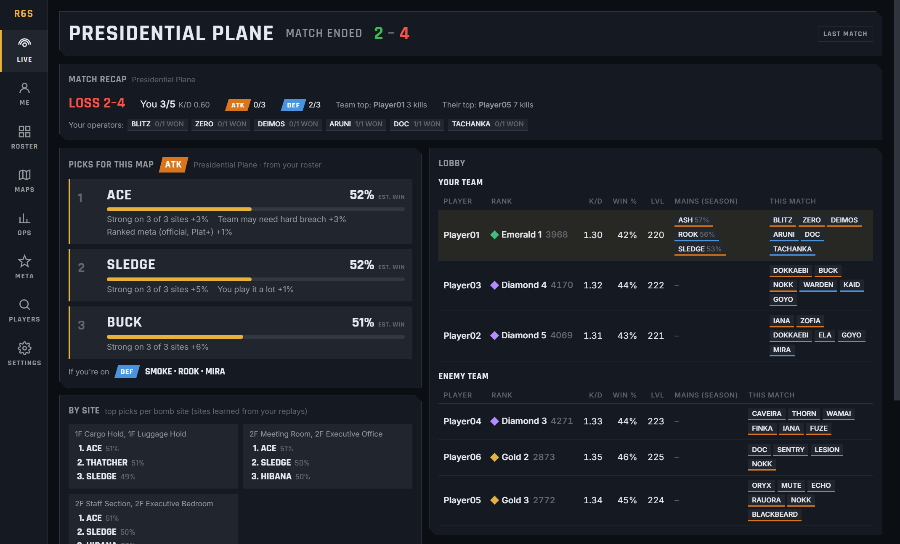

# RainbwStats

Ad-free, open-source Rainbow Six Siege X companion for Windows.

- **Live lobby**: detects your match automatically and shows map, side, both teams' ranks, K/D and W/L. You don't touch anything.
- **Operator picks for *you***: recommendations per map, site and side, weighted by your own stats on your chosen roster plus the meta.
- **Operator database**: pick rate and win rate per map, site, side and patch, built from real match replays.
- **Your history**: operator stats by map, site and side, plus rank snapshots over time.

**[Download](https://github.com/GLr-P/RainbwStats/releases/latest)** · **[Website](https://glr-p.github.io/RainbwStats/)** · Status: beta. See [PLAN.md](PLAN.md) for the roadmap.



## How it gets data (and why it's safe)

| Source | Used for |
|---|---|
| Siege's own **Match Replay** files on your disk | Map, site, every player's operator per round, outcomes |
| Ubisoft services, after you sign in on **Ubisoft's own login page** (Xbox / PlayStation / Facebook / email) | Ranks, RP, K/D, W/L for players in your lobby |
| Screen OCR (optional) | Map and side before round 1 |

RainbwStats **never reads or modifies game memory** and never injects anything into the game. It only
reads files Siege writes to disk and, optionally, your screen, the same way OBS or Discord does.

**Enable replays:** in Siege, go to *Options → General → Match Replay* and turn recording on.

## Disclaimer

Not affiliated with or endorsed by Ubisoft. Rainbow Six Siege is a trademark of Ubisoft Entertainment.
The Ubisoft services API is unofficial and may change. Consider logging in with an alternate account.
Signing in happens on Ubisoft's official page inside the app; RainbwStats only keeps the resulting session (encrypted with Windows DPAPI), never a password. Ubisoft doesn't offer Steam sign-in. Ban safety: the game and BattlEye never interact with the app (no memory access, no injection, no input automation), and Ubisoft API use is a handful of cached, batched requests per match, the same calls the official stats website makes.

## Development

```bash
npm install
npm run dev      # run the app with hot reload
npm run check    # typecheck + tests
npm run smoke    # build + launch + verify the window renders
npm run dist     # build Windows installer into release/
npm run shots    # screenshots of every page with scrubbed sample data → site/img
npm run export-dataset  # write the bundled dataset to site/data/meta/latest.json
```

MIT licensed.
